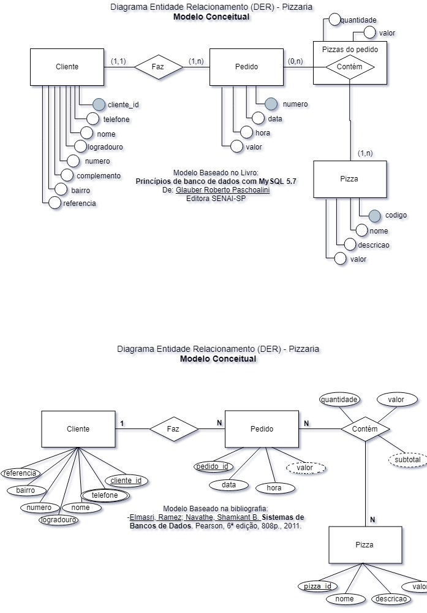
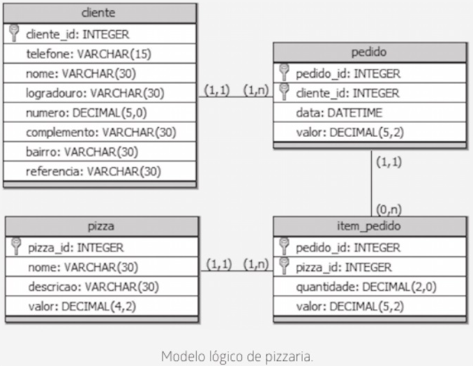

# Pizzaria

Atividade prática de Banco de Dados.

## Arquivos

- `script.sql`: criação e inserção de dados.
- `queries.sql`: consultas e views.
- `functions.sql`: funções.
- `procedures.sql`: procedimentos.
- `triggers.sql`: gatilhos.

## MER e DER

### Modelo Conceitual

### Modelo Lógico
